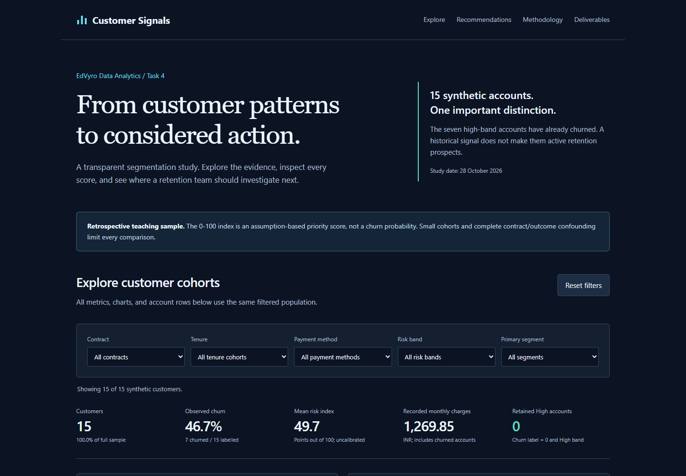
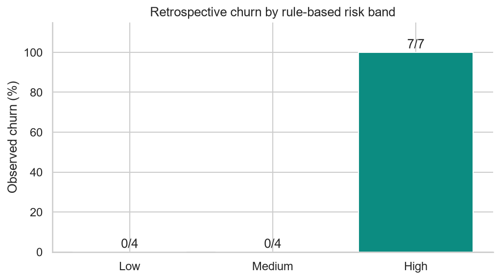

# Customer Segmentation & Explainable Churn Risk

**EdVyro Data Analytics Internship · Task 4: Segmentation and Recommendation Model**  
An auditable Python analysis and interactive report by [Dhaksith-S](https://github.com/Dhaksith-S).

| Required deliverable | Open supporting work |
| --- | --- |
| Analysis notebook | [Executed notebook, with charts and outputs](notebooks/Customer_Segmentation_and_Churn_Risk.ipynb) |
| Customer segment table | [Customer-level CSV](outputs/customer_segments.csv) · [Segment summary](outputs/segment_summary.csv) |
| Recommendation memo | [Business memo](reports/Customer_Retention_Recommendation_Memo.md) · [Typeset PDF](reports/Customer_Retention_Recommendation_Memo.pdf) |

**[Explore the interactive report](https://dhaksith-s.github.io/edvyro-customer-segmentation-churn-risk/)** · [Scoring specification](reports/Scoring_Methodology.md) · [Data quality report](reports/Data_Quality_Report.md) · [Data dictionary](reports/Data_Dictionary.md) · [Validation](reports/Validation_Report.md) · [Final audit](reports/Final_Requirement_Audit.md)

## Executive overview

This project moves from customer description to transparent prioritization using **15 synthetic subscription accounts**. All seven month-to-month customers are labelled churned, while all eight longer-contract customers are retained. The fixed index separates those historical groups, but its bands exactly reproduce contract cohorts: it adds **no demonstrated outcome information beyond contract alone**.

The decision is to investigate onboarding and service issues and design a controlled prospective pilot. All seven High-band records have already churned, so there are **zero retained High-band customers** to contact for retention in this snapshot. Recorded monthly charges must not be presented as revenue that an intervention could save.



## Business problem and objectives

A fictional subscription retention team needs understandable cohorts, reproducible customer-level explanations, and a recommendation grounded in available evidence. The project:

- Profiles source data and records every cleaning decision.
- Defines mutually exclusive primary segments and separate analytical dimensions.
- Computes a deterministic 0-100 rule index with no target inputs.
- Evaluates historical outcome separation and documents its limits.
- Supplies a memo with target audiences, KPIs, and controlled-test requirements.

## Dataset and provenance

Source: the supplied `customer_churn_sample.csv`, with 15 rows and 11 columns. Its EdVyro task brief describes synthetic data. The source library defines fictional charges in INR and support-ticket counts over the previous 90 days. The actual CSV uses `Month-to-Month`, `One Year`, and `Two Year`, overriding the generic guide's different contract examples. The supplied Markdown refers to Task 1; the implementation follows the user's Task 4 brief.

No missing values, duplicate customers, impossible values, or billing-identity discrepancies were found. All 15 customers were retained without changing source values. Tenure spans 2-48 months; charges are INR 49.99, 79.99, or 149.99; support tickets span 0-6. Outcome balance is seven churned and eight retained.

Raw source and supplied reference documents stay local and Git-ignored because no explicit source redistribution license was found. Public customer outputs omit raw IDs, age, gender and total charges; synthetic IDs are hashed. The code's MIT license does not grant rights to EdVyro materials. See [source retrieval and rights](data/README.md) and [the original profile/checksum](outputs/data_profile.json).

## Feature choices

| Feature | Role | Reason and limitation |
| --- | --- | --- |
| TenureMonths | Score and cohorts | Lifecycle; fixed onboarding/year boundaries; snapshot timing unknown |
| ContractType | Score and primary segments | Commitment; completely confounded with outcome in this small sample |
| MonthlyCharges | Score and spending cohorts | Absolute bill exposure, not affordability; partly proxies tier |
| SupportTickets | Behavioral service analysis | Previous-90-day service demand; chronology versus churn unverified, so excluded from score |
| PaymentMethod, SubscriptionType | Descriptive cohorts | No evidence supports penalizing payment methods |
| Churn | Outcome only | Never read by scoring or primary-segment functions |
| Age, Gender, IDs, TotalCharges | Excluded from scoring | Unnecessary demographics/identifiers; total charges mechanically equal tenure × monthly charges |

No usage behavior, failed payments, satisfaction, margin, intervention outcome, or exact dates are available. Prospective use requires verified pre-outcome snapshots of even the core account inputs.

## Segmentation

Every retained record receives exactly one primary segment; records with unknown tenure/contract enter Data review. Tenure, payment, subscription, spending, and risk dimensions are separate overlapping analyses.

| Primary segment | Definition | Customers | Share | Churned / labelled | Mean tenure |
| --- | --- | --- | --- | --- | --- |
| Flexible - first year | Monthly contract, tenure ≤12 months | 6 | 40.00% | 6/6 | 5.83 months |
| Flexible - beyond first year | Monthly contract, tenure >12 months | 1 | 6.67% | 1/1 | 14.00 months |
| Annual commitment | One Year contract | 4 | 26.67% | 0/4 | 19.75 months |
| Two-year commitment | Two Year contract | 4 | 26.67% | 0/4 | 38.50 months |

Displayed percentages can differ from 100% by rounding. Groups below five accounts receive a small-sample flag. Tenure bands are 0-5, 6-12, 13-24 and 25+ months, based on onboarding and annual-review assumptions. Spending bands are <70, 70-<100 and ≥100 INR, fixed cutoffs between observed tiers.

## Explainable scoring v1.0

```text
RiskScore = TenurePoints + ContractPoints + ChargePoints
```

| Signal | Condition | Points |
| --- | --- | --- |
| Tenure | 0-5 / 6-12 / 13-24 / 25+ months | 35 / 25 / 10 / 0 |
| Commitment | Month-to-Month / One Year / Two Year | 45 / 20 / 0 |
| Charge exposure | <70 / 70-<100 / ≥100 INR monthly | 0 / 10 / 20 |

**Low: 0-29. Medium: 30-59. High: 60-100.** Theoretical range is 0-100; observed range is 20-80. The weights and thresholds are planning assumptions, not fitted coefficients or empirically optimized cutoffs. The largest weight reflects ease of contract exit; tenure reflects early-lifecycle needs; charges are a modest value-review hypothesis. Missing/invalid core inputs yield a null score and `Unscored`, never a reassuring zero.

This is **not a calibrated churn probability or trained ML prediction model**. Rules were devised after source inspection; evaluation is retrospective and in-sample. Contract and tenure are correlated, and the extra charge signal is not validated by these outcomes. Individual exports show every contribution, including zero points. See [machine-readable rules](outputs/scoring_specification.csv) and [implementation](src/scoring.py).

## Actual findings

| Risk band | Customers | Churned / labelled | Observed churn | Recorded charges per month |
| --- | --- | --- | --- | --- |
| High | 7 | 7/7 | 100% | INR 409.93 |
| Medium | 4 | 0/4 | 0% | INR 259.96 |
| Low | 4 | 0/4 | 0% | INR 599.96 |

- Overall observed churn: **7/15 (46.67%)**; mean tenure **18.80 months**.
- Total recorded monthly-charge sum: **INR 1,269.85**; retained-account sum: **INR 859.92**. Neither is verified current MRR or expected loss.
- Six first-year flexible accounts average **4.50 support tickets**; annual and two-year cohorts average **1.50** and **0.50**. Timing and confounding prevent causal interpretation.
- High separates observed outcomes, while Medium and Low do not. There is no independent predictive validation. ROC-AUC is omitted because complete separation in n=15 would be misleading.



## Recommended next actions

Review service themes and onboarding for first-year flexible accounts, examine the single older flexible case qualitatively, and collect renewal dates before a value-review pilot with active one-year accounts. Maintain service quality for two-year accounts. Do not penalize payment methods or assume discounts/contract extensions work.

For a larger **active**, dated cohort, preregister the index and compare randomized assisted service against usual service over a fixed 90-day window. Measure intention-to-treat churn differences, uncertainty, repeat tickets, net retained margin, opt-outs, and complaints. Compare against contract-only and capacity-matched baselines. Sample size, intervention lift and ROI cannot be estimated from this file. The [memo](reports/Customer_Retention_Recommendation_Memo.md) provides the complete action matrix.

## Reproduce locally

Python 3.11 is the tested interpreter; [requirements-lock.txt](requirements-lock.txt) records the exact tested environment. From this repository root, in PowerShell:

```powershell
python -m venv .venv
.\.venv\Scripts\python.exe -m pip install -r requirements.txt
.\.venv\Scripts\python.exe scripts/download_data.py
.\.venv\Scripts\python.exe scripts/build_project.py
.\.venv\Scripts\python.exe scripts/execute_notebook.py
```

On macOS/Linux, replace `.\.venv\Scripts\python.exe` with `.venv/bin/python`. The downloader checks the original exact-byte SHA-256 before writing a Git-ignored raw file. If upstream retrieval changes or fails, place the authorized original CSV at `data/raw/customer_churn_sample.csv`. The supplied root-level CSV is also accepted locally. Rebuild uses no randomness. Public customer exports already contain every score input for independent score reproduction without raw data.

To run the core pipeline with another authorized source path:

```powershell
.\.venv\Scripts\python.exe -m src.pipeline --input path/to/customer_churn_sample.csv
```

`build_project.py` regenerates documentation, figures, exports, the PDF and an unexecuted notebook; **always run `execute_notebook.py` afterward** to restore saved notebook outputs. It uses the current environment's Python kernel; no manual user-level kernel installation is required.

### Tests and browser preview

```powershell
.\.venv\Scripts\python.exe -m playwright install chromium
.\.venv\Scripts\python.exe -m pytest -q --junitxml=tmp/test-results.xml
.\.venv\Scripts\python.exe -m http.server 8000 --directory docs
```

Open <http://localhost:8000> for preview. On Linux CI, use `python -m playwright install --with-deps chromium`. Tests start and stop their own isolated local HTTP server. The suite covers cleaning failures, all point/band boundaries, determinism, missing data, duplicate conflict handling, no target leakage, mutually exclusive segmentation, single-class/empty inputs, exported totals and fields, saved notebook outputs, every filter value, empty/reset states, score inspection, mobile width, load errors, and browser console errors. Pytest's optional cache plugin is disabled to avoid OneDrive directory-rename conflicts. See [validation evidence](reports/Validation_Report.md) for actual results and limits.

The website uses buildless HTML/CSS/JavaScript and local JSON: no external chart libraries, API keys, backend, paid hosting or tracking. All analytical panels use one filtered population. Fixed recommendation/method sections are labelled separately. GitHub Pages serves `main:/docs`; no custom build workflow or frontend secrets are required.

## Repository layout

```text
data/           Source retrieval, attribution and rights (raw files ignored)
src/            Cleaning, segmentation, scoring, summaries, exports and figures
scripts/        Build documentation/PDF/notebook; execute notebook; retrieve source
notebooks/      Complete executed analysis with saved charts
outputs/        De-identified customer tables, summaries, rules, dictionary and audits
reports/        Recommendation memo (Markdown/PDF), quality/method notes and figures
tests/          Automated analytical, notebook-artifact and real-browser checks
docs/           Responsive static interactive report and local analysis JSON
```

## Limits and attribution

Fifteen synthetic records and tiny cohorts are unsuitable for population inference, production forecasting, or estimating intervention efficacy. Mild class imbalance, complete contract/outcome confounding, correlated signals, unknown account-snapshot dates, and absent exact outcome horizons constrain validation. Support tickets might be post-churn. No temporal holdout, predictive calibration, causal claim, lift, or revenue-saved claim is made. Unit tests establish software behavior, not business utility.

Project author: **Dhaksith-S**. Prepared with Codex assistance; analytical claims are reproducible from the supplied data. Original code and writing: [MIT](LICENSE). Synthetic data and source guidance: [EdVyro](https://edvyro.in/datasets/source-materials/task-source-library#analytics); third-party rights remain separate. This is an internship portfolio exercise, not an official EdVyro product or operational customer model.

**Submission:** use [this public repository](https://github.com/Dhaksith-S/edvyro-customer-segmentation-churn-risk) as the one link containing all three mandatory deliverables.
